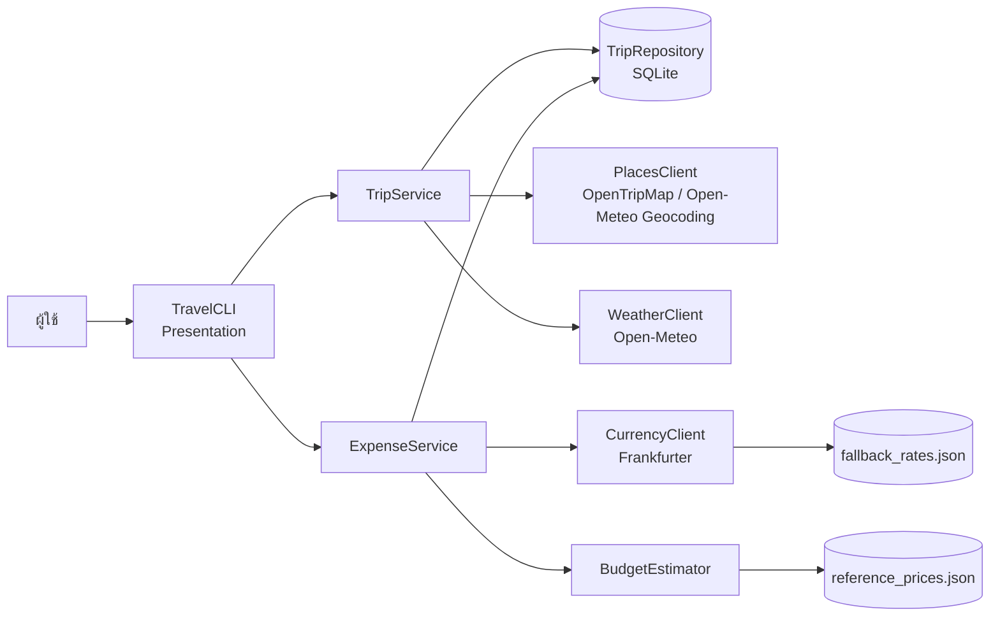

# PLAN.md: Sprint 3 (Full-Stack App Dev)

| หัวข้อ | รายละเอียด |
| --- | --- |
| โครงการ | Smart Travel Planner |
| Sprint | 3 (สัปดาห์ที่ 14): Full-Stack App Dev |
| นำเสนอ / ส่งงาน | 29-30/9/69 / 2/10/69 |
| Planner | อภิรักษ์ สุริยะศรี (รักษ์) |
| Coder | เอกปฐวี มีไชยา (ลีออง) |
| Debugger | ปวริศ สายโยค (โอ๊ค) |

## 1. เป้าหมายของ Sprint

เชื่อมเมนู CLI จาก Sprint 1 เข้ากับ Service และ Repository จาก Sprint 2 ให้ทำงานครบทุกเมนู ข้อมูลในโปรแกรมต้องตรงกับไฟล์ตลอดเวลา และรับมือกรณีขอบเขตได้โดยโปรแกรมไม่หยุดทำงาน

## 2. การเชื่อมต่อเลเยอร์

- `main.py` สร้างทุกออบเจกต์แล้วส่งต่อให้กัน (Dependency Injection แบบง่าย) เพื่อให้ทดสอบแต่ละส่วนแยกกันได้ใน Final Sprint
- CLI ไม่เรียก SQLite หรือ API โดยตรง ทุกอย่างผ่าน Service เท่านั้น

## 3. การจัดการ State และความสอดคล้องของข้อมูล

1. **เขียนลงไฟล์ทันที (Write-through):** ทุกการเพิ่ม/แก้ไข/ลบ commit ลง SQLite ทันที ไม่มีข้อมูลค้างในหน่วยความจำ ปิดโปรแกรมกะทันหันก็ไม่เสียข้อมูล
2. **อ่านใหม่ทุกครั้งที่แสดงผล:** ทุกหน้าจอดึงข้อมูลล่าสุดจากฐานข้อมูลก่อนแสดง
3. **ลบแบบ cascade:** ลบทริปแล้วสถานที่และค่าใช้จ่ายถูกลบตาม (Foreign Key `ON DELETE CASCADE`)
4. **ทริปสั้นลง:** เมื่อแก้วันเดินทางให้สั้นลง สถานที่ที่อยู่ในวันที่หายไปจะถูกย้ายเป็น "ยังไม่ได้จัดวัน" พร้อมแจ้งจำนวน
5. **แก้ค่าใช้จ่าย:** แปลงเป็นบาทใหม่ทุกครั้งที่แก้จำนวนเงินหรือสกุลเงิน
6. **ประมาณค่าใช้จ่าย:** คำนวณใหม่ทุกครั้งจากข้อมูลทริปและจำนวนสถานที่ล่าสุด ไม่เก็บผลเก่าไว้

## 4. ตารางกรณีขอบเขต (Edge Cases)

| กรณี | การรับมือ |
| --- | --- |
| ไม่มีอินเทอร์เน็ต / API ช้า | แจ้งข้อความภาษาไทย กลับเมนูเดิม ฟีเจอร์ที่ไม่ใช้ API ยังใช้ได้ |
| API key ผิดหรือไม่ได้ตั้ง | แจ้งตั้งแต่เปิดโปรแกรม และแจ้งอีกครั้งเมื่อค้นหาสถานที่ |
| หาพิกัดเมืองไม่ได้ | ให้เลือกบันทึกทริปโดยไม่มีพิกัด แล้วลองค้นหาใหม่ตอนแก้ไขทริป |
| หาพิกัดต้นทางไม่ได้ | ให้กรอกระยะทางเอง |
| ไฟล์ฐานข้อมูลเสียหาย | ย้ายไฟล์เดิมไปเป็น `travel_planner.corrupt-<เวลา>.db` แล้วสร้างใหม่ พร้อมแจ้งเตือน |
| ไฟล์ฐานข้อมูลถูกลบขณะใช้งาน | สร้างตารางใหม่อัตโนมัติ แจ้งว่าข้อมูลเก่าหายไป |
| ไฟล์ JSON หาย / เสีย / ข้อมูลไม่ครบ | ใช้ค่าเริ่มต้นในโค้ดแทน พร้อมแจ้งเตือน |
| API สกุลเงินใช้งานไม่ได้ | ใช้อัตราสำรอง ถ้าไม่มีสกุลนั้นในไฟล์ให้ปฏิเสธการบันทึก |
| ทริปไกลเกิน 16 วัน | แจ้งว่ายังพยากรณ์อากาศไม่ได้ |
| ทริปบางส่วนเกิน 16 วัน | แสดงเท่าที่พยากรณ์ได้ และบอกจำนวนวันที่แสดง |
| คำค้นหาว่าง | ช่องค้นหาทริปบังคับกรอก, ช่องค้นหาในรายการ Enter ว่าง = ล้างคำค้น |
| กรองแล้วไม่มีผลลัพธ์ | แจ้ง "ไม่มีรายการที่ตรงเงื่อนไข" และให้ล้างตัวกรองได้ |
| เลือกรหัส (ID) ที่ไม่มีอยู่ | แจ้ง "ไม่พบ..." แล้วกลับเมนู |
| ค่าสุดขอบ | จำกัดจำนวนคน 1-50, ทริปไม่เกิน 60 วัน, จำนวนเงินไม่เกิน 10,000,000, รัศมี 1-50 กม. |
| ข้อผิดพลาดที่ไม่คาดคิด | เมนูหลักมีตาข่ายรองรับสุดท้าย แจ้งข้อความแทนการปิดโปรแกรม |

## 5. ประวัติการปรับโครงสร้างโค้ด (Refactor History)

| # | ก่อน | หลัง | เหตุผล |
| --- | --- | --- | --- |
| 1 | แต่ละ API client จัดการ error เอง | รวมไว้ที่ `BaseApiClient._get_json()` | ข้อความ error เป็นแบบเดียวกัน แก้จุดเดียว |
| 2 | ทุกเมธอดใน Repository เปิด-ปิด connection และดักจับ error เอง | รวมไว้ที่ `TripRepository._run()` | ลดโค้ดซ้ำ และกู้คืนกรณีไฟล์ฐานข้อมูลหายได้ที่จุดเดียว |
| 3 | เมนูย่อยแต่ละเมนูเขียน loop ของตัวเอง | ใช้ `_menu_loop()` และ `_run_action()` ร่วมกัน | ทุกเมนูรับมือ error และคำสั่งกลับแบบเดียวกัน |
| 4 | หน้าค้นหาสถานที่และหน้าสถานที่ที่บันทึกไว้มีโค้ดกรองแยกกัน | ใช้ `ListQuery` และ `TripService.query_places()` ร่วมกัน | ค้นหา/กรอง/เรียงทำงานเหมือนกันทุกหน้าจอ |
| 5 | ตารางใช้ `str.ljust()` คอลัมน์ภาษาไทยเบี้ยว | ใช้ `display_width()` ที่ไม่นับสระบน-ล่างและวรรณยุกต์ | ตารางภาษาไทยตรงคอลัมน์ |

> ทีมแก้ไขตารางนี้ให้ตรงกับสิ่งที่เปลี่ยนจริงระหว่างพัฒนาได้

## 6. Definition of Done (DoD)

1. ทุกเมนูในโครงสร้างของ Sprint 1 ทำงานได้จริงผ่าน Service
2. Demo ครบวงจรได้: สร้างทริป → ค้นหาและบันทึกสถานที่ → จัดลงวัน → ดูอากาศ → ประมาณค่าใช้จ่าย → จดค่าใช้จ่าย → สรุปงบ → แก้ไข → ลบ
3. ปิดโปรแกรมแล้วเปิดใหม่ ข้อมูลทุกอย่างยังอยู่ครบ
4. ทุกกรณีในตารางข้อ 4 ไม่ทำให้โปรแกรมหยุดทำงานหรือแสดง Traceback
5. `scripts/seed_demo.py` เพิ่มข้อมูลตัวอย่างได้โดยไม่ต้องใช้อินเทอร์เน็ต (ใช้สำรองตอน Live Demo)
6. README มีวิธีติดตั้ง ตั้งค่า API key และวิธีใช้งาน
7. `PLAN.md` ฉบับนี้มี Class Diagram (Sprint 2), Data Model (Sprint 2) และประวัติการ Refactor

## 7. งานแยกตามบทบาท

| บทบาท | งาน |
| --- | --- |
| Planner (รักษ์) | เขียน PLAN.md, วาดแผนผังการเชื่อมต่อ, กำหนดตาราง Edge Case และ DoD, สรุปประวัติการ Refactor |
| Coder (ลีออง) | เขียน `main.py` เชื่อมทุกเลเยอร์, ปรับ CLI ให้เรียก Service, เพิ่มการรับมือ Edge Case, `scripts/seed_demo.py`, README |
| Debugger (โอ๊ค) | ทดสอบ End-to-End และ Edge Case ตาม REPORT.md, ทดสอบบน Windows, รีวิวและ merge PR |

## 8. ไฟล์ที่ส่งมอบ

- `main.py`, `scripts/seed_demo.py`
- `app/presentation/cli.py` (เวอร์ชันเชื่อมต่อ Service)
- `README.md`, `.env.example`, `.gitignore`, `requirements.txt`
- `docs/sprint3/PLAN.md`, `docs/sprint3/REPORT.md`
